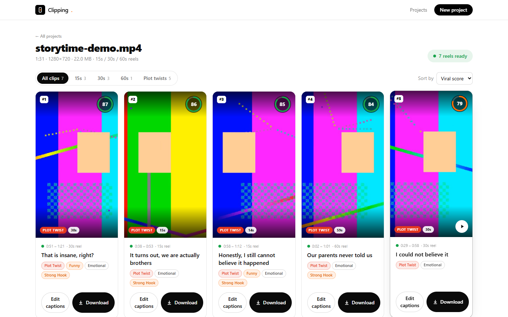
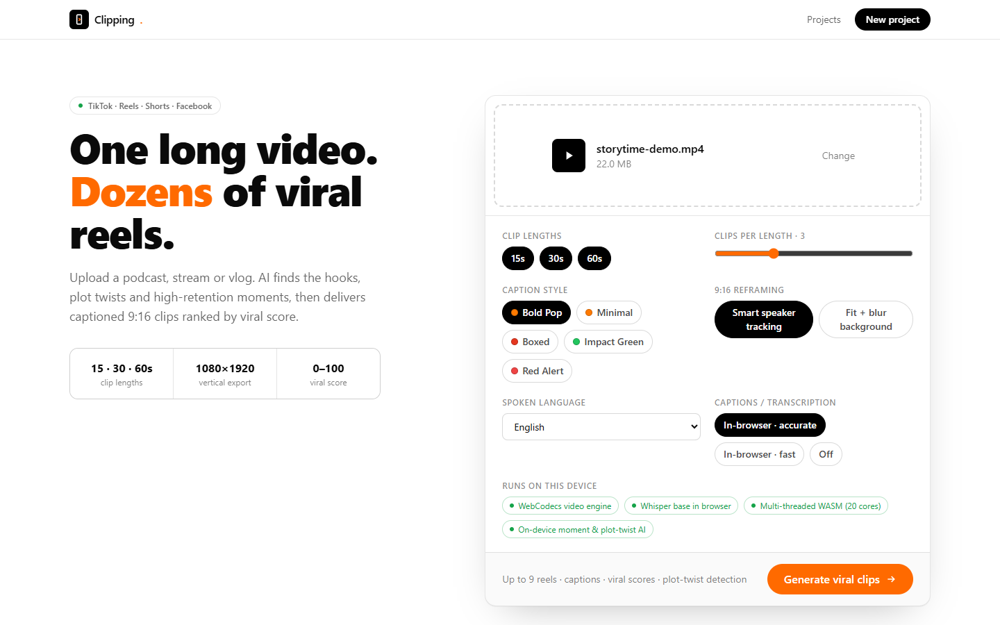
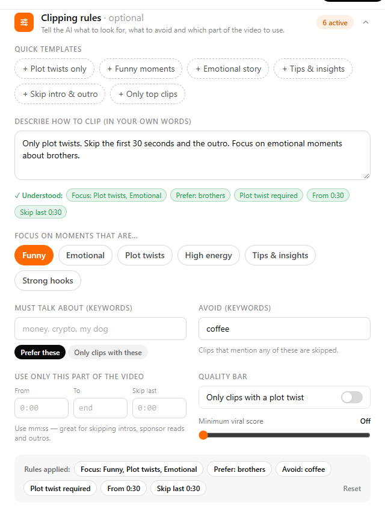
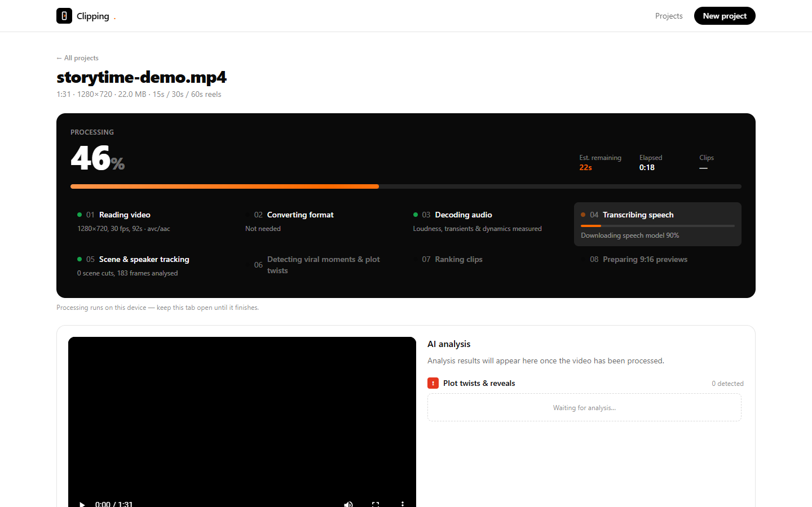
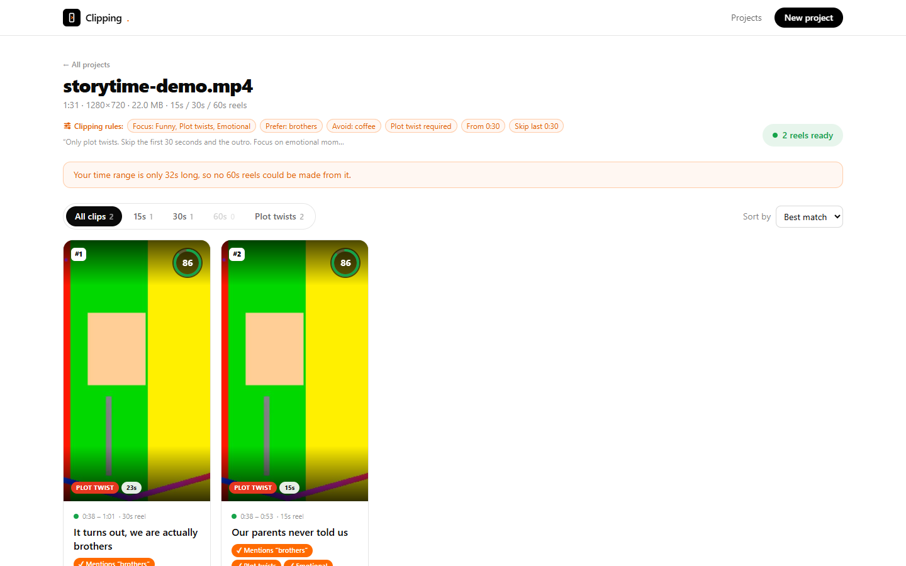
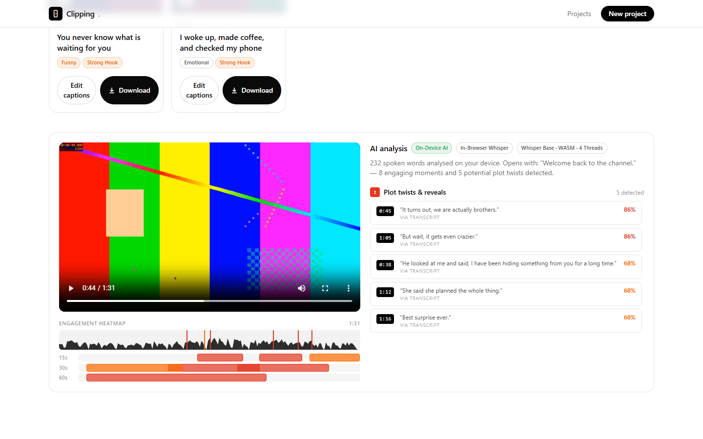
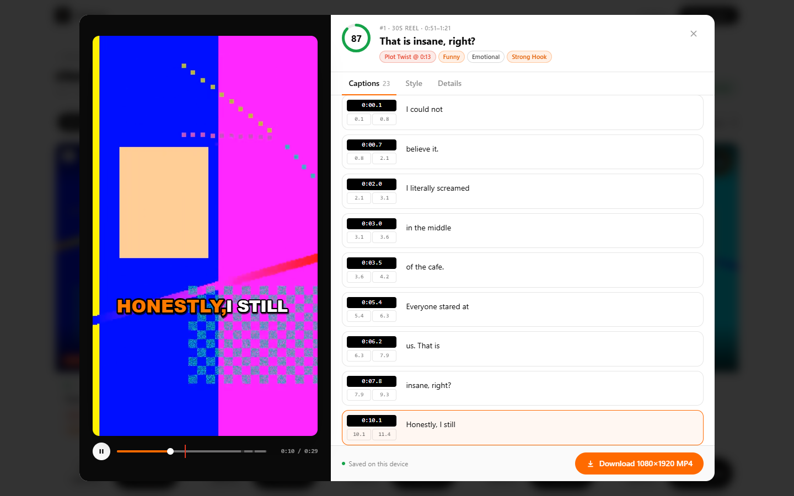
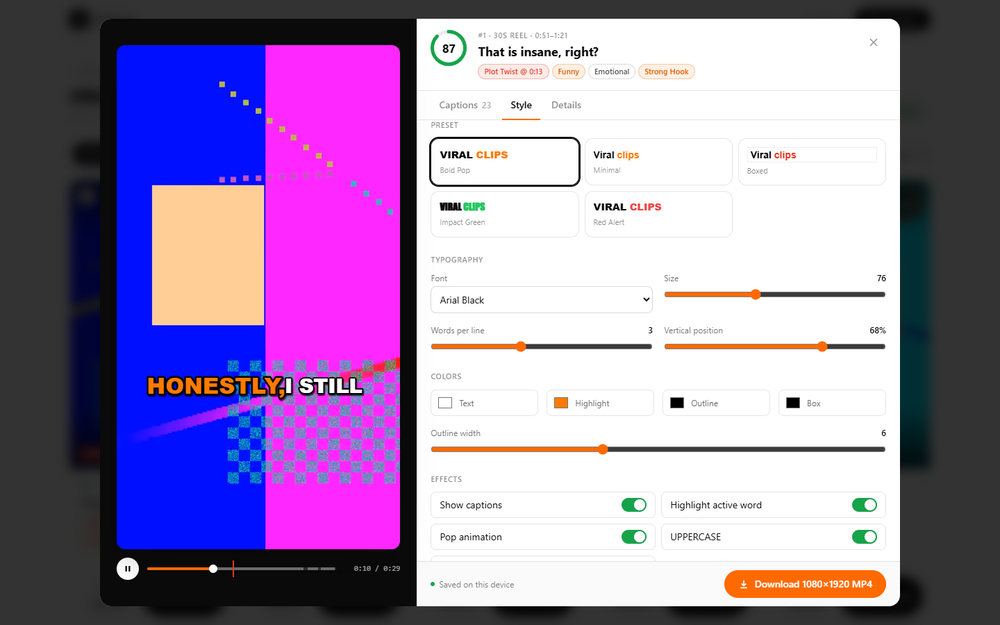
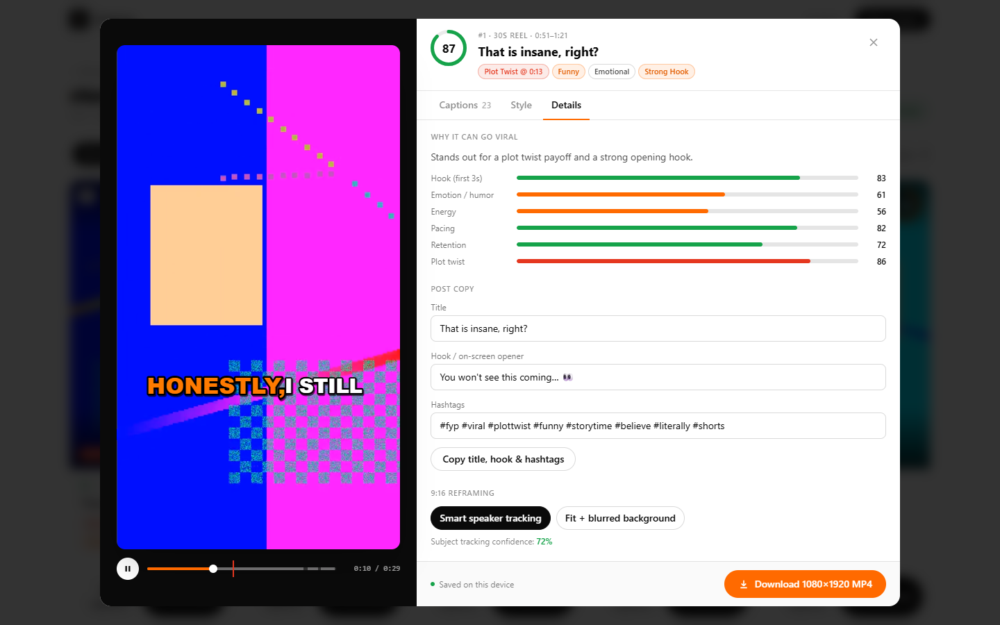

# Clipping: AI viral reels from long videos

> **Turn one long video into a stack of ready-to-post TikTok, Instagram Reels, YouTube Shorts and Facebook Reels clips. Everything runs in your browser.**



## In short

Drop in a podcast, stream, vlog or interview (MP4, MOV or AVI). Clipping then does the following:

- 🎯 **Finds the best moments:** funny, emotional, unexpected and high-energy parts of the video.
- 🧭 **Follows your clipping rules:** describe what you want in plain English, or set focus, keywords, time range and a quality bar.
- 🔀 **Detects plot twists:** reveals and "wait, what?!" moments, so every clip lands its payoff.
- 🏆 **Ranks clips by viral score (0–100):** the score combines the hook, emotion, energy, pacing, retention and twist.
- ✂️ **Cuts 15s, 30s and 60s reels:** clips start and end on full sentences, not mid-word.
- 💬 **Adds synced, word-by-word captions:** five styles, fully editable.
- 📱 **Reframes to 9:16 vertical:** smart speaker tracking keeps the person in frame.
- ⬇️ **Exports with one click:** a 1080×1920 MP4 with captions burned in.

🔒 **Private by design.** The video is never uploaded. Transcription, analysis, previews and export all run on your own device (WebCodecs, in-browser Whisper and WebAssembly).

---

## How to use

### 1. Drop in your video and pick your settings

Open the app, then drag a video onto the upload box (or click it to browse).



| Setting | What it does |
| --- | --- |
| **Clip lengths** | Which reel lengths to make: 15s, 30s and/or 60s. |
| **Clips per length** | How many reels to make for each length (1–8). |
| **Caption style** | Starting look for the captions: Bold Pop, Minimal, Boxed, Impact Green or Red Alert. You can change it per clip later. |
| **9:16 reframing** | **Smart speaker tracking** follows the speaker or main subject. **Fit + blur background** keeps the whole frame, which is best for wide shots. |
| **Spoken language** | Helps the speech recognition. |
| **Captions / transcription** | **Accurate** (better captions) or **Fast** (quicker), both in the browser. You can also turn transcription **Off** for videos without speech. |

Click **Generate viral clips** when you're ready. Before that, you can optionally set your clipping rules (step 2).

### 2. Set your clipping rules (optional)

Below the settings, the **Clipping rules** section tells the AI *how* to clip, before anything is generated.



- **Describe how to clip, in your own words.** Type something like *"Skip the first 2 minutes, focus on funny moments about money. Avoid swearing."* The app shows what it **understood** as green chips while you type, entirely on your device.
- **Quick templates:** one click for *Plot twists only*, *Funny moments*, *Emotional story*, *Tips & insights*, *Skip intro & outro* or *Only top clips*.
- Or fine-tune the rules yourself:

| Rule | What it does |
| --- | --- |
| **Focus on moments that are…** | Funny, Emotional, Plot twists, High energy, Tips & insights, Strong hooks. Matching clips are ranked higher. |
| **Must talk about** | Keywords to look for. Choose **Prefer these** (rank higher) or **Only clips with these** (required). |
| **Avoid** | Clips that mention any of these words are skipped. |
| **Use only this part of the video** | **From** / **To** (mm:ss) and **Skip last** let you cut intros, sponsor reads and outros. |
| **Quality bar** | **Only clips with a plot twist**, and a **minimum viral score**. |

The **Rules applied** bar shows everything that will be used. Your rules are remembered for the next video, and **Reset** clears them.

Example instructions the app understands:

| You type | Understood as |
| --- | --- |
| *Only plot twists. Skip the intro and outro.* | Focus: Plot twists · Plot twist required · From 0:30 · Skip last 0:30 |
| *Clips must mention crypto or bitcoin. No sponsor reads.* | Must mention: crypto, bitcoin · Avoid: sponsor reads |
| *Only from 10:00 to 25:30, give me tips and advice, minimum score 70* | Focus: Tips & insights · From 10:00 · Until 25:30 · Viral score ≥ 70 |
| *Emotional story about my mom, without sad music* | Focus: Emotional · Prefer: mom · Avoid: sad music |

> If no clip can satisfy every rule, the app relaxes them step by step and tells you what it changed, so you always get clips. With cloud AI enabled, your instructions are also passed to GPT.

### 3. Watch it work

The video is analysed right in your browser. You can see each step, the overall progress, the estimated time remaining, and how many clips are ready.



> ⏱️ A 90-second video takes about 1–2 minutes. The first run also downloads the speech model once (about 40–80 MB), and after that it's cached. **Keep the tab open while it processes.**

### 4. Browse your reels

When processing finishes, your reels appear ranked by **best match**, which combines viral potential with how well each clip fits your rules:

- **Hover** a card for a live 9:16 preview with captions.
- **Filter** by 15s, 30s or 60s, or by **Plot twists**.
- **Sort** by best match, viral score, or position in the original video.

If you set clipping rules, they're listed under the project title, and each clip shows which rules it **matched** (orange ✓ chips):



Scroll down to the **AI analysis** panel. It shows an engagement heatmap of the whole video, where each clip sits on the timeline, and every detected plot twist with a confidence score. Click a twist to jump to it.



### 5. Polish a clip

Click **Edit captions** on any reel to open the editor. Every change shows instantly in the preview and is saved automatically in your browser.

**Captions tab:** fix words, adjust timings, and add or delete caption lines. The current line is highlighted as the video plays.



**Style tab:** pick a preset, or customise the font, size, words per line, position, colours and outline. You can also toggle the active-word highlight, the pop animation, uppercase and a background box.



**Details tab:** see *why* the clip can go viral (the score breakdown). You can edit the title, hook and hashtags and copy them in one click, or switch between smart tracking and fit-with-blurred-background.



### 6. Download and post

Click **Download 1080×1920 MP4**, either in the editor or on a clip card. The reel is rendered in your browser and saved to your Downloads folder, ready to upload to TikTok, Reels, Shorts or Facebook.

### Tips

- Videos where **people talk** (podcasts, interviews, storytimes, vlogs) give the best results, because the AI reads the speech for hooks and twists.
- For wide or group shots where tracking can't lock on, switch the clip to **Fit + blurred background**.
- Your projects stay in *this* browser on *this* device. The home page shows how much storage they use. Delete old projects to free up space.

---

## Build & run

### Requirements

- **Node.js 20.9+** (tested on Node 24)
- A recent **Chrome, Edge, Firefox or Safari** (it needs WebCodecs)

### Development

```bash
git clone https://github.com/ttolaaa/ClippingEditor.git
cd ClippingEditor
npm install        # also copies ffmpeg.wasm into public/ffmpeg (postinstall)
npm run dev        # http://localhost:3000
```

### Production

```bash
npm run build
npm start          # runs the standalone server on http://localhost:3000 (same as the Docker image)
```

Type-check with `npm run lint`.

> Keep the `Cross-Origin-Opener-Policy` / `Cross-Origin-Embedder-Policy` headers from `next.config.ts`, because they enable multi-threaded WebAssembly for faster transcription.

### Optional: cloud AI (`.env.local`)

No keys are needed. To add GPT-written titles and hashtags, extra moment analysis, and a "Cloud Whisper API" transcription option, copy `.env.example` to `.env.local` and set:

```bash
OPENAI_API_KEY=sk-...
OPENAI_MODEL=gpt-4o-mini
OPENAI_TRANSCRIBE_MODEL=whisper-1
OPENAI_BASE_URL=             # optional OpenAI-compatible endpoint
```

The key stays on the server, and the browser goes through the `/api/ai/*` proxy. GPT receives only the transcript **text**. Audio is sent to the server only if you pick "Cloud Whisper API".

---

## Deploy with Docker Compose (auto-updates on every commit)

Pick **one** of the two options below. Both keep the app running at `http://<server>:3000` and redeploy it automatically when you push a new commit to `main`.

| | Option A: Registry + Watchtower (recommended) | Option B: Build on the server |
| --- | --- | --- |
| Compose file | `docker-compose.yml` | `docker-compose.build.yml` |
| Where the image is built | GitHub Actions | Your server |
| Server needs | Docker only | Docker + a git clone of the repo |
| Update flow | push → CI builds and publishes `ghcr.io/ttolaaa/clippingeditor` → Watchtower pulls it | push → the `updater` container sees the new commit → `git pull` → rebuild → restart |
| Typical delay | CI build (~3 min) + poll interval | poll interval + server build (~2 min) |

**Requirements:** Docker Engine 24+ with the Compose plugin (v2.24+). The published image (Option A) is `linux/amd64`. On ARM servers (e.g. a Raspberry Pi), use Option B, which builds natively.

### Option A: GitHub Actions + Watchtower (recommended)

```
git push ──▶ GitHub Actions (.github/workflows/docker.yml)
              │  type-check → docker build → push ghcr.io/ttolaaa/clippingeditor:latest (+ :sha-xxxxxxx)
              ▼
        your server ──▶ Watchtower polls the registry every 60s
              │  new image? pull it → recreate the `clipping` container → remove the old image
              ▼
        http://<server>:3000 is now running the new commit
```

1. **Push to `main`.** The workflow builds and publishes the image automatically. You can follow it under the repo's **Actions** tab, and the image appears under **Packages**.
2. **On the server**, create a folder containing `docker-compose.yml` and a `.env` file:

   ```bash
   mkdir clipping && cd clipping
   curl -fsSLO https://raw.githubusercontent.com/ttolaaa/ClippingEditor/main/docker-compose.yml   # or copy it over
   curl -fsSL -o .env https://raw.githubusercontent.com/ttolaaa/ClippingEditor/main/.env.example
   ```

   **Make the image public once** (it starts out private even in a public repo): on GitHub, open **Packages → clippingeditor → Package settings → Change visibility → Public**. After that, the server can pull it with no login.

   If you'd rather keep the image private, create a GitHub token (classic) with the **`read:packages`** scope, then log in and give Watchtower the same credentials in `.env`:

   ```bash
   echo "<token>" | docker login ghcr.io -u <github-username> --password-stdin
   # .env
   REGISTRY_USER=<github-username>
   REGISTRY_TOKEN=<token>
   ```
3. **Start it:**

   ```bash
   docker compose up -d
   docker compose ps                       # app should become "healthy"
   curl http://localhost:3000/api/health   # {"status":"ok","version":"<git sha>",...}
   ```

That's it. Every new commit on `main` is live about a minute after its CI build finishes. `/api/health` reports which commit is running.

**Instant updates (optional).** Instead of waiting for the poll, CI can tell Watchtower to update right away:
- On the server, set `WATCHTOWER_HTTP_API=true`, `WATCHTOWER_TOKEN=<long random string>` and `WATCHTOWER_BIND=0.0.0.0` in `.env`, then run `docker compose up -d`.
- In the GitHub repo, add the secrets **`WATCHTOWER_URL`** (`http://<server>:8080`) and **`WATCHTOWER_TOKEN`**.

Put port 8080 behind a firewall or reverse proxy if you can.

**Roll back / pin a version:** set `APP_IMAGE=ghcr.io/ttolaaa/clippingeditor:sha-<7-char-sha>` in `.env` and run `docker compose up -d`. Watchtower only updates the tag you pin.

### Option B: Build from source on the server (no registry)

```bash
git clone https://github.com/ttolaaa/ClippingEditor.git
cd ClippingEditor
cp .env.example .env          # GIT_TOKEN is only needed if you fork it into a private repo
docker compose -f docker-compose.build.yml up -d --build
```

The `updater` service (`deploy/auto-update.sh`) runs `git fetch` every `UPDATE_INTERVAL` seconds. When `origin/main` has new commits, it resets the clone to that commit and runs `docker compose up -d --build app`. If a build fails, the previous version keeps running. To see what it's doing:

```bash
docker compose -f docker-compose.build.yml logs -f updater
```

> The updater resets the clone to `origin/main`, so don't edit files inside that clone on the server. Keep settings in `.env`, which is git-ignored.

### Useful settings (`.env`)

| Variable | Default | Purpose |
| --- | --- | --- |
| `PORT` | `3000` | Host port for the app |
| `UPDATE_INTERVAL` | `60` | Seconds between update checks |
| `APP_IMAGE` | `ghcr.io/ttolaaa/clippingeditor:latest` | Image to run (Option A) |
| `REGISTRY_USER` / `REGISTRY_TOKEN` | — | GHCR login, only if the image is private (Option A) |
| `DEPLOY_BRANCH` / `GIT_TOKEN` | `main` / — | Branch to follow, and repo token for private forks (Option B) |
| `OPENAI_API_KEY` … | — | Optional cloud AI (see above) |

### HTTPS

Browsers only allow the features this app relies on (WebCodecs, multi-threaded WASM, video downloads) on **`https://`** or `localhost`. In production, put the app behind a TLS reverse proxy, e.g. [Caddy](https://caddyserver.com):

```
clips.example.com {
  reverse_proxy localhost:3000
}
```

---

## How it works

| Step | Runs in | Tech |
| --- | --- | --- |
| Project and video storage | Browser (IndexedDB) | `src/lib/browser/db.ts`, `store.ts` |
| Probe, audio decode, visual tracking, thumbnails | Web Worker | [Mediabunny](https://mediabunny.dev) / WebCodecs (`media.worker.ts`) |
| AVI and other unsupported formats | Browser | ffmpeg.wasm → H.264/AAC MP4 (`convert.ts`) |
| Audio WebCodecs can't decode (some browsers) | Browser | ffmpeg.wasm fallback (`convert.ts`) |
| Speech-to-text with word timings | Web Worker | Whisper via [transformers.js](https://huggingface.co/docs/transformers.js), multi-threaded WASM (`whisper.worker.ts`) |
| Viral moments, plot twists, scoring, crop paths | Browser | `src/lib/engine/*` |
| Clipping rules: plain-English parsing, filtering, re-ranking | Browser | `engine/rules.ts`, `engine/select.ts` |
| Live 9:16 preview with captions | Browser (canvas) | `ReelPlayer` + `engine/renderer.ts` |
| 1080×1920 MP4 export with burned-in captions | Web Worker | Mediabunny `Conversion` (H.264 + AAC) |
| *Optional:* GPT titles and moments, Whisper API | Server proxy | `/api/ai/*`, only if `OPENAI_API_KEY` is set |

The preview player and the exporter share **one canvas renderer**, so what you see in the editor is exactly what you download.

```
src/
├─ app/                 Next.js pages + API routes (/api/ai/* optional proxy, /api/config, /api/health)
├─ components/          UI: upload, clipping rules, processing dashboard, clip grid, editor, ReelPlayer
└─ lib/
   ├─ browser/          IndexedDB store, pipeline orchestration, Web Workers, ffmpeg.wasm fallback
   ├─ engine/           Pure analysis: signals, moments & plot twists, rules, scoring, reframing, renderer
   └─ server/           OpenAI helpers for the optional proxy
Dockerfile, docker-compose*.yml, deploy/   Container image + auto-updating deployments
.github/workflows/docker.yml               CI: build & publish the image on every push to main
```

Built with Next.js, TypeScript, Tailwind CSS, Mediabunny, transformers.js and ffmpeg.wasm.
