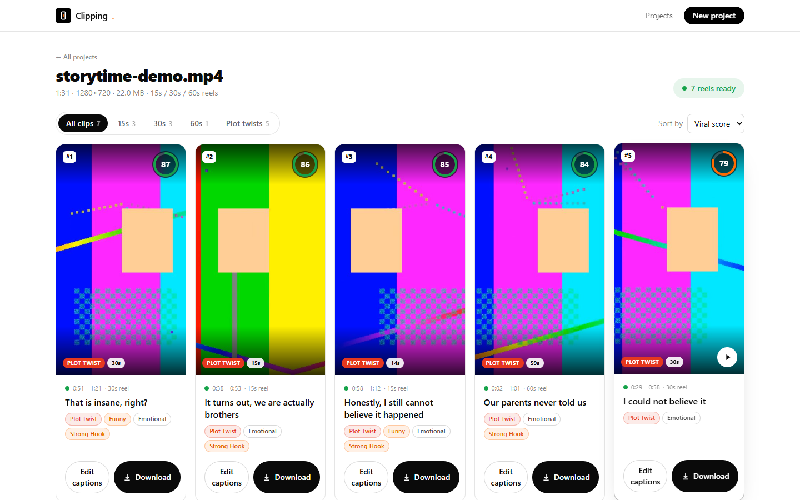
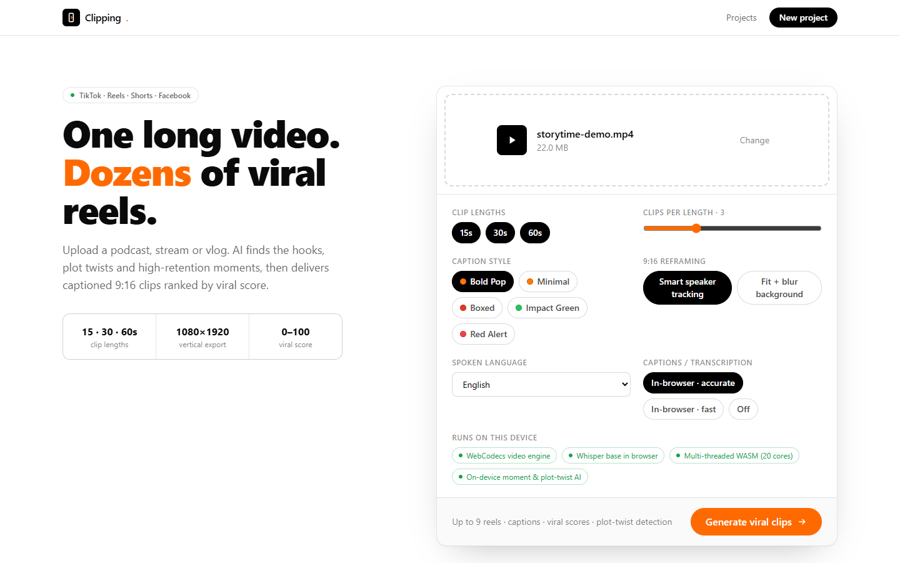
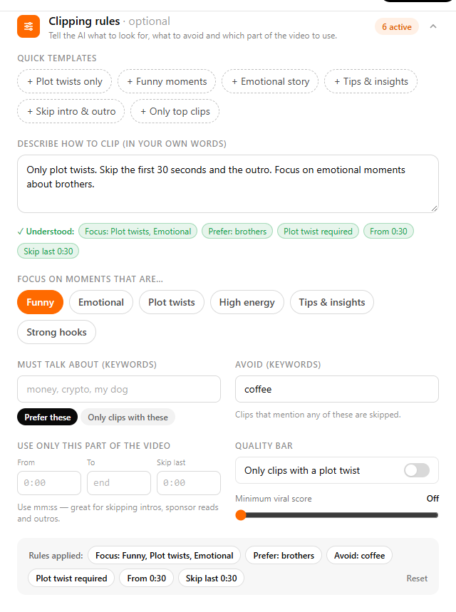
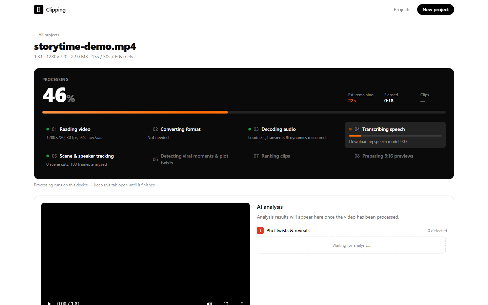
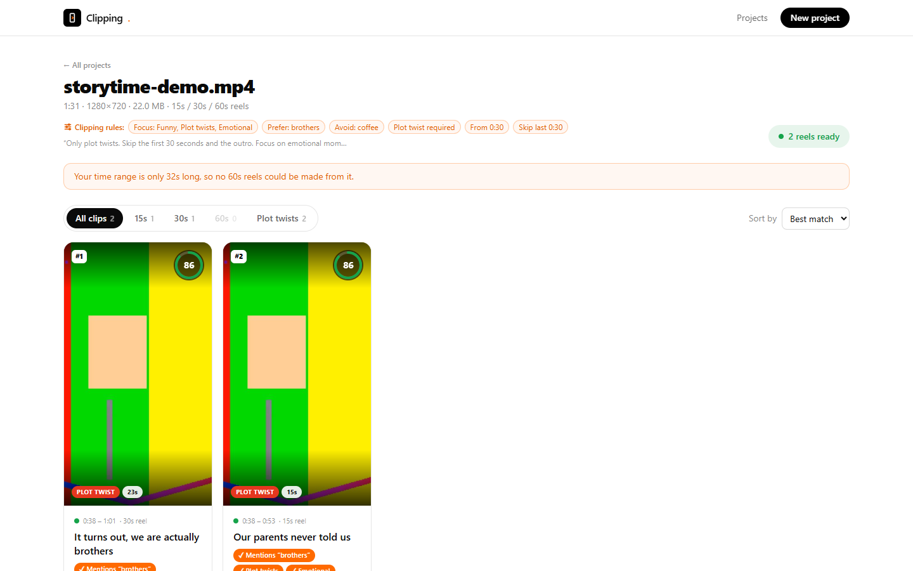
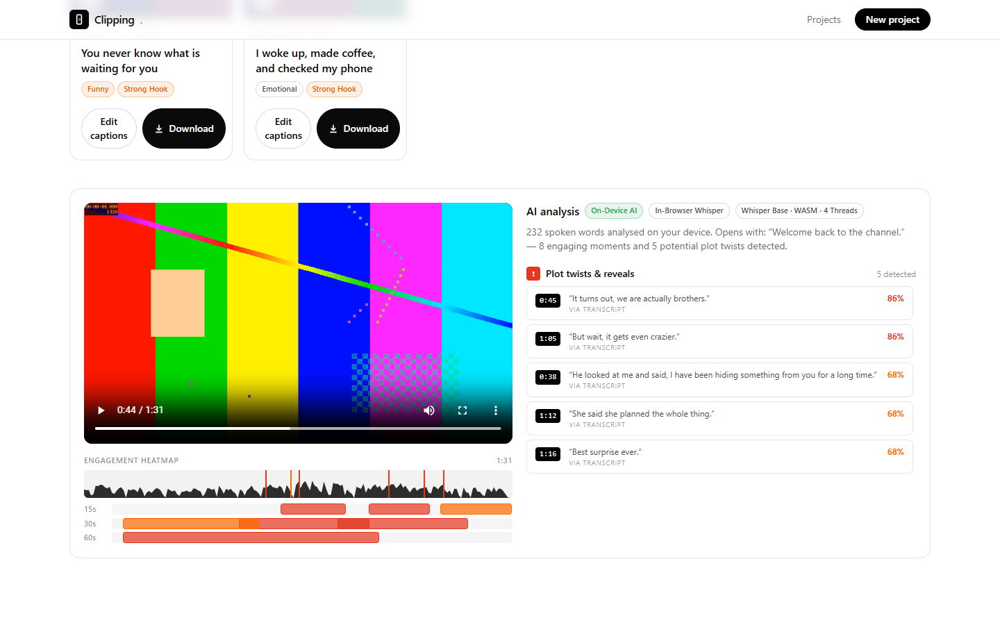
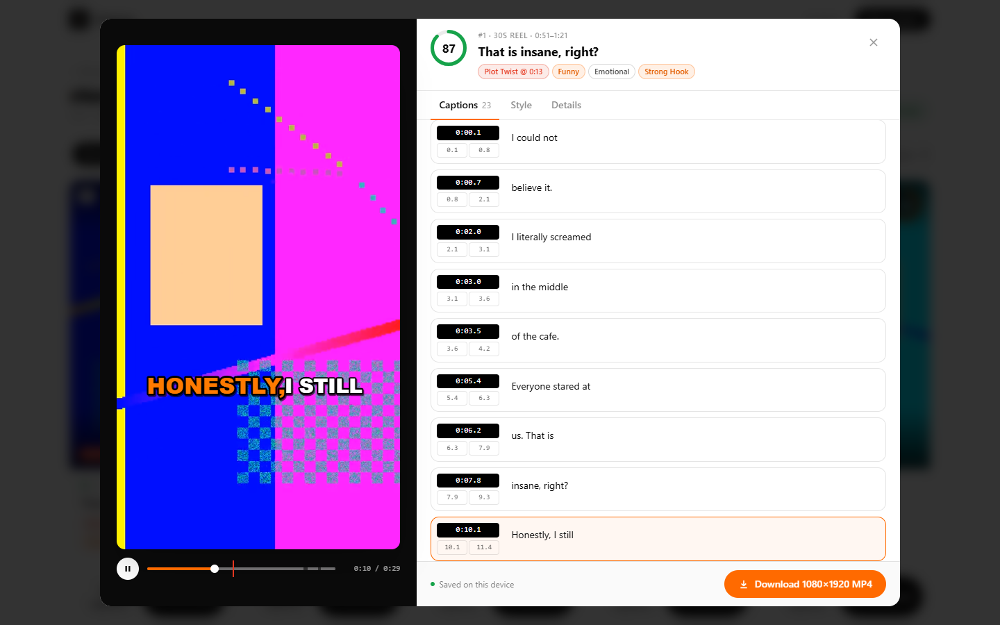
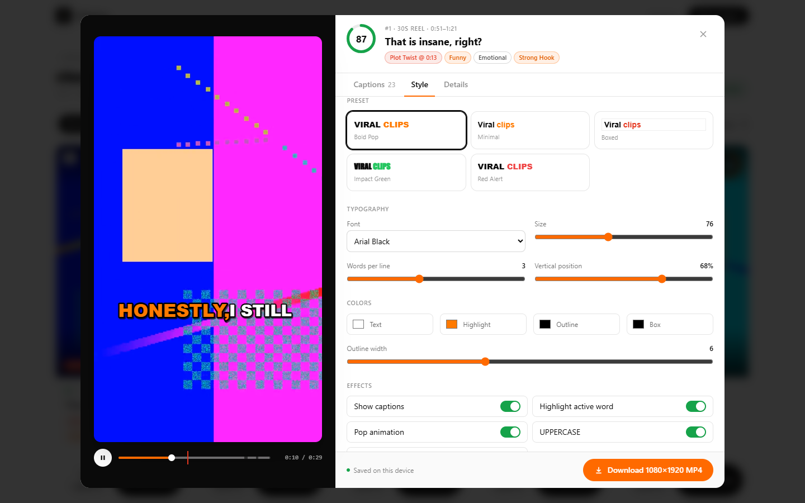
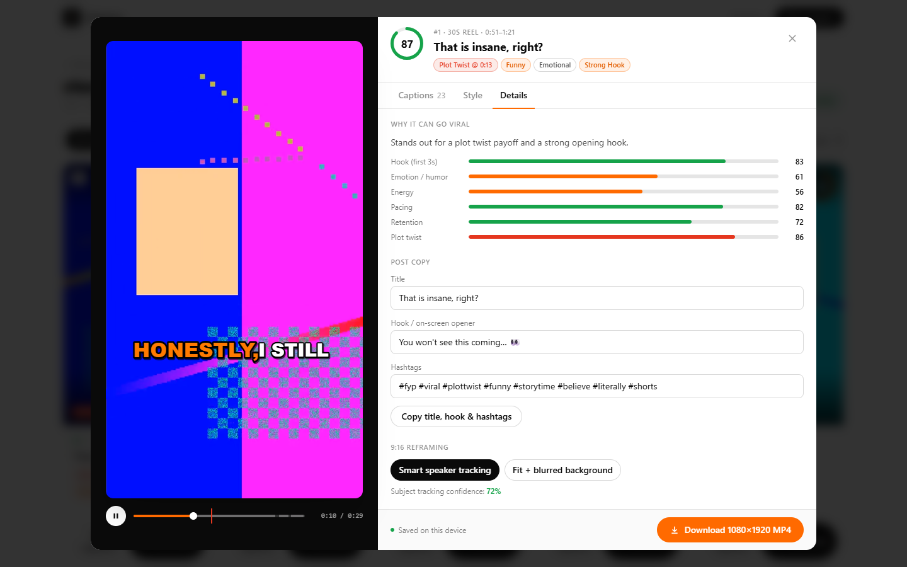

# Clipping: AI viral reels from long videos

> **Turn one long video into a stack of ready-to-post TikTok, Instagram Reels, YouTube Shorts and Facebook Reels clips. Everything runs in your browser.**
>
> 🎌 **New: Anime Clipper.** Clip Japanese videos into Reels with **furigana** and an automatic **English translation**. See [Anime Clipper](#anime-clipper).



## In short

Drop in a podcast, stream, vlog or interview (MP4, MOV or AVI). Clipping then does the following:

- 🎯 **Finds the best moments:** funny, emotional, unexpected and high-energy parts of the video.
- 🧭 **Follows your clipping rules:** describe what you want in plain English, or set focus, keywords, time range and a quality bar.
- 🔀 **Detects plot twists:** reveals and "wait, what?!" moments, so every clip lands its payoff.
- 🏆 **Ranks clips by viral score (0–100):** the score combines the hook, emotion, energy, pacing, retention and twist.
- ✂️ **Cuts 15s, 30s and 60s reels:** clips start and end on full sentences, not mid-word.
- 💬 **Adds synced, word-by-word captions:** five styles, fully editable.
- 📱 **Reframes to 9:16 vertical:** smart speaker tracking keeps the person in frame.
- ⬇️ **Exports with one click:** a 1080×1920 MP4 with captions burned in.

🔒 **Private by design.** The video is never uploaded. Transcription, analysis, previews and export all run on your own device (WebCodecs, in-browser Whisper and WebAssembly).

🎌 **Two clippers in one app.** Use the switch in the header: **Viral Clipper** (everything above) or **Anime Clipper** (Japanese clips with furigana and English subtitles, see [Anime Clipper](#anime-clipper)).

---

## How to use

### 1. Drop in your video and pick your settings

Open the app, then drag a video onto the upload box (or click it to browse).



| Setting | What it does |
| --- | --- |
| **Clip lengths** | Which reel lengths to make: 15s, 30s and/or 60s. |
| **Clips per length** | How many reels to make for each length (1–8). |
| **Caption style** | Starting look for the captions: Bold Pop, Minimal, Boxed, Impact Green or Red Alert. You can change it per clip later. |
| **9:16 reframing** | **Smart speaker tracking** follows the speaker or main subject. **Fit + blur background** keeps the whole frame, which is best for wide shots. |
| **Spoken language** | Helps the speech recognition. |
| **Captions / transcription** | **Accurate** (better captions) or **Fast** (quicker), both in the browser. You can also turn transcription **Off** for videos without speech. |

Click **Generate viral clips** when you're ready. Before that, you can optionally set your clipping rules (step 2).

### 2. Set your clipping rules (optional)

Below the settings, the **Clipping rules** section tells the AI *how* to clip, before anything is generated.



- **Describe how to clip, in your own words.** Type something like *"Skip the first 2 minutes, focus on funny moments about money. Avoid swearing."* The app shows what it **understood** as green chips while you type, entirely on your device.
- **Quick templates:** one click for *Plot twists only*, *Funny moments*, *Emotional story*, *Tips & insights*, *Skip intro & outro* or *Only top clips*.
- Or fine-tune the rules yourself:

| Rule | What it does |
| --- | --- |
| **Focus on moments that are…** | Funny, Emotional, Plot twists, High energy, Tips & insights, Strong hooks. Matching clips are ranked higher. |
| **Must talk about** | Keywords to look for. Choose **Prefer these** (rank higher) or **Only clips with these** (required). |
| **Avoid** | Clips that mention any of these words are skipped. |
| **Use only this part of the video** | **From** / **To** (mm:ss) and **Skip last** let you cut intros, sponsor reads and outros. |
| **Quality bar** | **Only clips with a plot twist**, and a **minimum viral score**. |

The **Rules applied** bar shows everything that will be used. Your rules are remembered for the next video, and **Reset** clears them.

Example instructions the app understands:

| You type | Understood as |
| --- | --- |
| *Only plot twists. Skip the intro and outro.* | Focus: Plot twists · Plot twist required · From 0:30 · Skip last 0:30 |
| *Clips must mention crypto or bitcoin. No sponsor reads.* | Must mention: crypto, bitcoin · Avoid: sponsor reads |
| *Only from 10:00 to 25:30, give me tips and advice, minimum score 70* | Focus: Tips & insights · From 10:00 · Until 25:30 · Viral score ≥ 70 |
| *Emotional story about my mom, without sad music* | Focus: Emotional · Prefer: mom · Avoid: sad music |

> If no clip can satisfy every rule, the app relaxes them step by step and tells you what it changed, so you always get clips. With cloud AI enabled, your instructions are also passed to GPT.

### 3. Watch it work

The video is analysed right in your browser. You can see each step, the overall progress, the estimated time remaining, and how many clips are ready.



> ⏱️ A 90-second video takes about 1–2 minutes. The first run also downloads the speech model once (about 40–80 MB), and after that it's cached. **Keep the tab open while it processes.**

### 4. Browse your reels

When processing finishes, your reels appear ranked by **best match**, which combines viral potential with how well each clip fits your rules:

- **Hover** a card for a live 9:16 preview with captions.
- **Filter** by 15s, 30s or 60s, or by **Plot twists**.
- **Sort** by best match, viral score, or position in the original video.

If you set clipping rules, they're listed under the project title, and each clip shows which rules it **matched** (orange ✓ chips):



Scroll down to the **AI analysis** panel. It shows an engagement heatmap of the whole video, where each clip sits on the timeline, and every detected plot twist with a confidence score. Click a twist to jump to it.



### 5. Polish a clip

Click **Edit captions** on any reel to open the editor. Every change shows instantly in the preview and is saved automatically in your browser.

**Captions tab:** fix words, adjust timings, and add or delete caption lines. The current line is highlighted as the video plays.



**Style tab:** pick a preset, or customise the font, size, words per line, position, colours and outline. You can also toggle the active-word highlight, the pop animation, uppercase and a background box.



**Details tab:** see *why* the clip can go viral (the score breakdown). You can edit the title, hook and hashtags and copy them in one click, or switch between smart tracking and fit-with-blurred-background.



### 6. Download and post

Click **Download 1080×1920 MP4**, either in the editor or on a clip card. The reel is rendered in your browser and saved to your Downloads folder, ready to upload to TikTok, Reels, Shorts or Facebook.

To get every reel at once, click **Download all (.zip)** at the top of the project page. The clips are rendered one after another (with overall progress and a **Cancel** button) and saved together as a single ZIP, e.g. `my-video-8-reels.zip`, so the browser doesn't ask to allow multiple downloads. If a length filter is active (for example **30s**), the button says **Download N shown** and only those clips are included.

### Tips

- Videos where **people talk** (podcasts, interviews, storytimes, vlogs) give the best results, because the AI reads the speech for hooks and twists.
- For wide or group shots where tracking can't lock on, switch the clip to **Fit + blurred background**.
- Your projects stay in *this* browser on *this* device. The home page shows how much storage they use. Delete old projects to free up space.

---

## Anime Clipper

Open **Anime Clipper** from the switch in the header (`/anime`). Drop an anime episode (or any Japanese-language video) and it **finds the most viral moments automatically**, cuts them into ranked 30-second, 60-second and 2-minute Reels, and subtitles each one with **Japanese + furigana** and an **English translation**. Like the rest of the app it runs in your browser; nothing is uploaded.

It has three modes, switchable at the top of the page:

| | **Auto viral clips** (default) | **Split into clips** | **Manual range** |
| --- | --- | --- | --- |
| Picks the clips | The app analyses the whole video and ranks the best moments by viral score | The whole video, cut back to back from start to end | You choose one exact time range |
| Clip lengths | 30s, 60s and/or 2 min, several per length | 30s, 60s or 2 min (a 60-minute video gives 120, 60 or 30 clips) | Whatever range you type |
| Subtitles | Optional: on (generated for every clip) or off | Optional: with or without subtitles | Optional: on (generated for your range) or off |
| Saved | Yes, as a project in this browser (listed under **Your anime projects**) | No: each clip is downloaded (or saved to a folder) as soon as it's ready | No: download the subtitle JSON to keep your edits |

Compared with the Viral Clipper, the frame is **never cropped** (the whole picture is kept, centred in 9:16), and captions are bilingual subtitles rather than word-by-word captions.

### Auto viral clips, step by step

1. **Drop a video:** landscape or portrait. Formats the browser can't play (AVI, MKV…) are converted on-device.
2. **Pick your settings:**

   | Setting | What it does |
   | --- | --- |
   | **Clip lengths** | 30s, 60s and/or 2 min. A 2-minute reel needs a video of at least about 1.5 minutes. |
   | **Clips per length** | How many reels to make for each length (1–6). |
   | **Japanese speech recognition** | **Fast**, **Balanced** (default) or **Best**; see [Speech recognition quality](#speech-recognition-quality). |
   | **Subtitles** | **With subtitles** (default) or **No subtitles**. With subtitles off, the speech is still scanned to find the moments, but the subtitle pass (translation and furigana) is skipped and the clips have no subtitles. |
   | **Subtitle / transcript files** (optional) | Your Japanese and/or English subtitle files. **The most accurate option**; see [Using your own subtitle files](#using-your-own-subtitle-files). |
   | **Default subtitle layout** | A, B, C or D, plus blurred or dark fill. You can change it per clip later. |
3. **Find viral anime clips.** You're taken to the project page, which shows live progress: reading the video, decoding audio, **transcribing the Japanese**, scene tracking, **detecting viral moments & plot twists** (Japanese cues such as まさか, 実は, すごい, 泣, ありがとう, laughter, shouting and scene energy), ranking, then **translating & adding furigana** for the lines inside the picked clips. Keep the tab open while it works.
4. **Browse the reels:** ranked by viral score, with filters for each length and for plot twists. Hover a card for a live preview with subtitles. Titles come from the English translation.
5. **Edit subtitles:** opens the clip editor with a live preview, the layout picker (A–D and the fill), and every subtitle line (see [Editing subtitles](#editing-subtitles)). Edits save automatically in this browser.
6. **Download 1080×1920 MP4** on a card or in the editor, or **Download all (.zip)** at the top of the project to get every reel in one file.

How long it takes: only the parts of the video with speech are transcribed (music and silence are skipped), and only the picked clips get the slower, accurate second pass. The first run also downloads the models once.

### Split into clips, step by step

1. **Video:** drop an episode or movie.
2. **Clip length:** **30 s**, **60 s** or **2 min**. The whole video is cut into back-to-back clips of that length; the last clip is whatever is left over.
3. **Subtitles:** **With subtitles** (pick a speech model, layout A–D, romaji and text size) or **No subtitles** (just the letterbox fill). Clips without speech are exported without subtitles.
4. **Export:** optionally **Choose save folder** (Chrome/Edge) so clips are written straight into a folder; otherwise each clip downloads as soon as it's rendered (`<name>-part01.mp4`, `-part02.mp4`, …). Clips are made one at a time and you can **Cancel** at any point. Keep the tab open while it works.

### Manual range, step by step

1. **Video:** drop a landscape or portrait video.
2. **Clip range:** type a start and end (`m:ss`, `m:ss.s` or plain seconds), or move the playhead and press **Use playhead**.
3. **Subtitles & layout:** choose **With subtitles** or **No subtitles**, then pick A–D and the fill (see below). With **No subtitles**, step 4 is hidden and the clip is exported without subtitles.
4. **Subtitles:** pick a speech model (**Accurate** is the default), then press **Generate Japanese + furigana + English**. Or press **Import subtitles** to load a subtitle file (.srt, .vtt, .ass/.ssa, timestamped .txt or the app's JSON): a Japanese file gives exact Japanese lines (with furigana and machine-translated English), and an English file fills in the English of the matching lines.
5. **Review and edit**, then **Download 1080×1920 MP4**.

> ⚠️ Manual mode keeps your work in the open tab only. Reloading or leaving the page clears it, so use **Download JSON** if you want to come back to your edits.

### Using your own subtitle files

Speech recognition and on-device translation can't be perfect (see below). If you have the video's subtitles, add them, either when you start an auto project (**Subtitle / transcript files**) or later on the project page (**Import subtitles** → **Rebuild clip subtitles**).

| You add | Japanese comes from | English comes from |
| --- | --- | --- |
| Japanese + English files | your Japanese file (**exact**) | your English file (**exact**) |
| Japanese file only | your Japanese file (**exact**) | machine translation, labelled *machine translation — check it before posting* |
| English file only | speech recognition | your English file where it has a line at that moment, machine translation elsewhere |
| Nothing | speech recognition | machine translation |

- **Formats:** `.srt`, `.vtt`, `.ass`/`.ssa` (sign and karaoke lines are skipped), text lines starting with a time (`[01:23] …`), and the app's subtitle JSON. Styling tags are removed.
- **Encodings:** UTF-8, UTF-16 and the Japanese encodings Shift_JIS / EUC-JP are detected automatically.
- **Language:** detected automatically per file (Japanese or English). You can change it in the list.
- **Offset:** if a file is timed for a slightly different release of the video (lines appear early or late), set the offset in seconds (e.g. `-1.5`).
- **Matching:** English lines are matched to Japanese lines by time overlap.
- With a Japanese file, **speech recognition is skipped entirely**, so processing is much faster. In testing, a 3-minute video finished in about 11 seconds. Clips are picked using the exact text.
- Each line in the clip editor says where its English came from: *from your subtitle file*, *machine translation*, or *edited by you*.

**For every English line to be correct, add an English subtitle file.** The on-device translator is small. In testing on *Grave of the Fireflies*, both it and the larger FuguMT model mistranslated some lines even with perfect Japanese input (for example 死にはったんか, "She passed away?", came out as "Did you die?"), mostly because of Kansai dialect and missing context.

### Subtitle layouts

| Option | Result |
| --- | --- |
| **A** Japanese + English | Japanese with furigana on top, English below |
| **B** Japanese only | Japanese with furigana |
| **C** English only | English translation |
| **D** English + Japanese | English on top, Japanese with furigana below |

**Letterbox fill** is either a blurred copy of the video or a solid dark colour.

**Romaji** (optional) adds the reading in Latin letters under the Japanese, for example 私は学生です → *watashi wa gakusei desu*. It follows the line's furigana, has spaces between words, and reads particles the spoken way (は → wa, へ → e, を → o). It's made automatically and updates when you edit a line.

**Text size** (70–150%, or A− / A+) scales all subtitle text. Very long lines still shrink to fit the space below the video. Both settings are per clip, apply to the preview and the exported MP4, and can be set as defaults when you start an auto project.

### Speech recognition quality

Auto mode works in two passes: a quick model scans the whole video to find the best moments, then **only the picked clips are re-transcribed with an accurate model** for the subtitles (minutes of audio instead of the whole film).

| Preset (auto mode) | Scan / subtitles | Download (once) | Best for |
| --- | --- | --- | --- |
| **Fast** | Whisper tiny / base | ~120 MB | Quick drafts; rougher subtitles |
| **Balanced** (default) | Whisper base / small | ~330 MB | Accurate subtitles at a reasonable speed |
| **Best** | Whisper base / **large-v3-turbo** | ~800 MB | The most accurate Japanese the browser can do; slowest |
| **Cloud AI (Gemini)** | Whisper base / **Gemini** | ~80 MB | **Most accurate.** Shown, and selected by default, when the server has a `GEMINI_API_KEY` (see [Cloud AI with Gemini](#cloud-ai-with-gemini-most-accurate)) |

Manual mode transcribes one range with the model you pick: **Fast** (tiny), **Balanced** (base), **Accurate** (small, default), **Best (large)** (large-v3-turbo, 4-bit, ~720 MB) or **Cloud AI (Gemini)** when the server has a Gemini key.

#### Cloud AI with Gemini (most accurate)

Services such as Vocova transcribe Japanese well because they run large AI models on servers. With a Gemini key on the server, the Anime Clipper does the same for the subtitles:

1. A quick on-device scan still analyses the whole video and picks the viral clips, so no audio leaves the browser for this step.
2. **Exact timing from your device, text from Gemini.** The on-device voice detector (Silero VAD, which ignores music and effects) finds every stretch of speech in the picked clips. Only those snippets are sent to Gemini through the app's server (`/api/ai/anime-transcribe`), numbered and in batches of up to about 90 seconds of speech, with the previous lines as context. Gemini writes the text for each snippet; **the timing comes from the voice detector, never from the model**. If one snippet holds two sentences, they share its time in proportion to their length.
3. Gemini writes the Japanese the way a subtitler would: correct kanji from context, with dialect kept as spoken. It also translates each line **from the audio, with the scene's context** (tone, who is speaking). This avoids the line-by-line mistakes of the small on-device translator.
4. Gemini also gives the **furigana in context**: a reading for every kanji word as it's actually pronounced there (一人→ひとり, 今日→きょう, 後で→あとで), where a dictionary would have to guess. Each reading is checked: it must be kana and match the word in the line, and okurigana stays plain (食べる → 食 gets た). The on-device dictionary fills in anything missing or rejected. Translating a Japanese subtitle file with Gemini returns the same context readings.
5. Subtitles stay up long enough to read the English, and short pauses are bridged. If voice detection fails, the app falls back to Gemini's own timestamps. Those are repaired (broken ones are re-anchored to the on-device scan) and snapped to the voice, and the lines are marked **Needs review** when the timing had to be estimated.
6. If Gemini fails (quota, network), the clip falls back to the on-device Accurate model automatically, and a warning says so.

To transcribe a finished project's clips again (for example after adding a Gemini key, or after an app update), press **Redo subtitles** on the project page. This replaces the current subtitles, including your edits.

Your own subtitle files still come first: a Japanese file skips speech recognition, and an English file overrides the English. With a Gemini key and no OpenAI key, the other cloud text features (viral-moment analysis, titles, translating a Japanese subtitle file) also use Gemini. Each line's English is labelled *cloud AI translation from the audio*. Set it up in [Optional: cloud AI](#optional-cloud-ai-envlocal).

The first run also downloads the voice detector (~2 MB), the translation model (~110 MB) and the furigana dictionary (~18 MB); after that everything is cached. Model downloads retry automatically if the network drops.

Speech recognition runs on the CPU (multi-threaded WebAssembly). On computers with an NVIDIA, AMD or Apple GPU it runs on the GPU via WebGPU instead, and falls back to the CPU automatically if anything goes wrong. On integrated Intel graphics the GPU measured no faster than the CPU and needs a larger second download, so those machines stay on the CPU.

#### How the Japanese is kept accurate

Whisper (the speech model) **invents text when it hears music, sound effects or silence**. On a feature film that is most of the runtime, and it shows up as loops like "さて、さて、さて…" or "もう一度、もう一度…" and phantom lines like "ご視聴ありがとうございました". The app guards against this in layers:

1. **Voice activity detection** ([Silero VAD](https://github.com/snakers4/silero-vad), runs in the browser): only stretches that contain speech are sent to Whisper. In testing on a film, speech was 15–30 % of the audio, so this also makes transcription several times faster.
2. **A token cap per speech window**, so a runaway loop can't produce pages of text.
3. **A hallucination filter** (`src/lib/engine/hallucination.ts`) that collapses loops to at most two copies (keeping real repetition like "さあ、さあ"), removes Whisper's known phantom phrases (closing lines, subtitle credits, bracketed sound effects) and drops windows with more text than anyone could say in that time.
4. **Subtitle line clean-up**: filler-only lines ("あ", "ん") are dropped (reactions like "え?" are kept), and implausibly long timings are trimmed.

#### How the English is kept correct

The on-device translator (opus-mt, ~110 MB) is small, so the app helps it and checks its work (`src/lib/anime/normalize.ts`, `translate-guard.ts`, `names.ts`):

- **Dialect normalisation:** anime is full of Kansai-ben and casual speech the model wasn't trained on. Before translating, common forms are rewritten to standard Japanese (やで → だよ, あらへん → ない, 早よ → 早く, 気ぃつけて → 気をつけて, ほんま → 本当…). In testing this fixed several meaning flips (for example 「絶対やで」 went from "Absolutely not." to "I promise.").
- **Names:** character names are swapped for placeholders the model handles reliably, then the real name is put back ("せっちゃん、お兄ちゃんの言うこと聞くんよ" → "Setchan, you're gonna listen to your brother.").
- **Fixed phrases:** short reactions and greetings use exact subtitle translations (え？ → "Huh?", 大丈夫？ → "Are you okay?", さようなら → "Goodbye.").
- **Output checks:** every translation is checked for loops, counting ("one, two, three…"), runaway length, profanity the Japanese doesn't contain and stock filler sentences. A bad result is retried with stricter settings, then translated phrase by phrase; if it still fails, the English is left **empty rather than wrong**, ready to type in the editor.

**What to expect.** These steps remove the garbage (loops, invented lines, nonsense translations), but they can't fix words the speech model *mishears*. On a 1988 film with music, sound effects and Kansai dialect, the accurate model still mishears some words, such as place names, and the English for those lines will be off. That's why lines get flagged for review (below).

#### "Needs review" flags

The app can't guarantee every line is right, so it tells you **which lines to check**. A line is flagged (amber, with the reason) when:

- the translation failed its checks, needed a fallback, or is empty (*"no reliable English — please type it"*);
- the Japanese contains words the dictionary doesn't know, a typical sign of a mishearing (*"some words may be misheard"*);
- the quick scan and the accurate pass heard clearly different words at that moment (*"the two speech passes heard different words"*).

Each clip card shows **⚠ N subtitle lines to review**, and the editor's **N need review** button jumps to the first one. Editing the Japanese or English clears the flag, or press **✓ Looks right**. **↻ Auto furigana** keeps the flag, because adding readings doesn't confirm the words.

Furigana also has a correction list for common words the dictionary misreads in speech (一人 → ひとり, 後で → あとで, 大人 → おとな, お母ちゃん → かあ, 節ちゃん → せっちゃん…). It only applies when the word stands on its own, so compounds such as 大人気 (だいにんき) are left alone.

### Editing subtitles

Every line can be changed, and the preview updates instantly:

- **Times:** edit the start and end of a line (changes apply when you leave the field).
- **Japanese:** plain text or ruby markup, e.g. `<ruby>漢<rt>かん</rt></ruby>字`. Fix a wrong reading by editing the text inside `<rt>…</rt>`.
- **↻ Auto furigana:** re-generate the readings after you change the Japanese text.
- **English:** edit the translation.
- **+ Add line at playhead**, **▶ Go to** and **Delete** manage lines. The line playing in the preview is highlighted.
- **Download JSON** (and **Import JSON** in manual mode): save subtitles, load them back later, or bring in subtitles made elsewhere (see [Subtitle JSON](#subtitle-json)).

Export renders the clip with the subtitles burned in (H.264 video, AAC audio). You can cancel while it renders.

### How it looks

- **The source is never cropped or stretched.** It keeps its aspect ratio and is centred in the 9:16 canvas.
- **Landscape videos** (16:9, 21:9…) leave empty bands above and below the video. The bottom band holds the subtitles.
- **Portrait or tall videos** (9:16 and similar) have little or no margin, so they are scaled down just enough to free a subtitle band (about a quarter of the height). The blur or dark fill shows at the sides.
- **Furigana** sits directly above its kanji only (okurigana stays plain, e.g. 食(た)べる). Readings are never split across lines, and lines reserve room for the furigana, so nothing overlaps.
- **Line breaks** are balanced, prefer the natural pause after `、`, and never start a line with punctuation such as `。` or `、`. Long text shrinks to fit the band.
- A small area at the very bottom stays empty so subtitles aren't hidden by the Reels/Shorts buttons and captions.

### How the subtitles are made

| Step | Runs in | Tech |
| --- | --- | --- |
| Audio for the selected range | Web Worker | WebCodecs; ffmpeg.wasm when the browser can't decode the audio (export uses the same fallback, so the audio is never dropped) |
| Finding speech | Web Worker | Silero VAD (`onnx-community/silero-vad`) via transformers.js |
| Speech to Japanese text | Web Worker | Whisper (tiny / base / small, language fixed to Japanese) via transformers.js, speech windows only, plus the hallucination filter |
| Splitting into subtitle lines | Browser | Sentence ends, pauses and length limits; loops, phantom and filler-only lines are removed (`src/lib/anime/subtitles.ts`) |
| Japanese → English | Web Worker (default) | `Xenova/opus-mt-ja-en` with dialect normalisation, name protection, fixed phrases and output checks (`src/lib/browser/translate.worker.ts`) |
| Japanese → English (optional) | Server proxy | GPT or Gemini via `/api/ai/translate` when `OPENAI_API_KEY` or `GEMINI_API_KEY` is set. Falls back to the on-device model if it's refused or fails |
| Japanese speech → Japanese + English (optional) | Server proxy | Gemini via `/api/ai/anime-transcribe` when `GEMINI_API_KEY` is set (picked clips only; ~90 s audio pieces; timings snapped to the voice, `src/lib/anime/cloud-speech.ts`) |
| Furigana | Browser | [kuromoji](https://github.com/sglkc/kuromoji.js) morphological analysis, readings aligned to the kanji (`src/lib/anime/furigana.ts`, `ruby.ts`; dictionary self-hosted in `public/kuromoji-dict`) |
| Preview and export | Browser / Web Worker | One shared canvas renderer (`src/lib/anime/renderer.ts`) + Mediabunny (H.264 + AAC) |

Speech recognition and machine translation are not perfect, especially for fast, noisy or music-heavy scenes, names and slang (see [What to expect](#how-the-english-is-kept-correct)). Review the lines before exporting.

### Subtitle JSON

*Download JSON* writes, and *Import JSON* reads, this structure (times are absolute seconds in the source video). On import, Japanese can be given as `segments`, as `ruby` markup, or just as plain `text` (furigana is then added automatically). A bare array of subtitle objects is accepted too.

```json
{
  "version": 1,
  "sourceLanguage": "ja",
  "targetLanguage": "en",
  "video": { "name": "episode1.mp4", "duration": 1420.5 },
  "clip": { "start": 62.0, "end": 98.5 },
  "subtitles": [
    {
      "id": "s1",
      "start": 63.2,
      "end": 65.8,
      "text": "今日は天気がいいですね。",
      "ruby": "<ruby>今日<rt>きょう</rt></ruby>は<ruby>天気<rt>てんき</rt></ruby>がいいですね。",
      "segments": [
        { "text": "今日", "ruby": "きょう" },
        { "text": "は" },
        { "text": "天気", "ruby": "てんき" },
        { "text": "がいいですね。" }
      ],
      "en": "The weather is nice today."
    }
  ]
}
```

| Field | Meaning |
| --- | --- |
| `start`, `end` | Seconds in the source video. Lines with `end <= start` are skipped on import. |
| `text` | Plain Japanese. |
| `ruby` | The same Japanese with standard HTML ruby markup (`<rp>` and `<rb>` are accepted on import). |
| `segments` | Structured form: each run of text, with `ruby` (hiragana reading) only on runs that contain kanji. |
| `en` | English translation. |

### Tips

- Pick ranges with clear dialogue; background music and overlapping voices lower recognition quality.
- Keep clips short (under about a minute) for Reels. Generation works on the selected range only, so a short range is also faster.
- Subtitle fonts come from the system (Yu Gothic, Hiragino, Noto Sans JP, Meiryo…). The device that exports needs a Japanese-capable font, which Windows, macOS, iOS and Android include.

---

## Build & run

### Requirements

- **Node.js 20.9+** (tested on Node 24)
- A recent **Chrome, Edge, Firefox or Safari** (it needs WebCodecs)

### Development

```bash
git clone https://github.com/ttolaaa/ClippingEditor.git
cd ClippingEditor
npm install        # also copies ffmpeg.wasm into public/ffmpeg and the furigana dictionary into public/kuromoji-dict (postinstall)
npm run dev        # http://localhost:3000
```

### Production

```bash
npm run build
npm start          # runs the standalone server on http://localhost:3000 (same as the Docker image)
```

Type-check with `npm run lint`.

> Keep the `Cross-Origin-Opener-Policy` / `Cross-Origin-Embedder-Policy` headers from `next.config.ts`, because they enable multi-threaded WebAssembly for faster transcription.

### Optional: cloud AI (`.env.local`)

No keys are needed. To add GPT-written titles and hashtags, extra moment analysis, a "Cloud Whisper API" transcription option, and GPT translation in Anime Clipper, copy `.env.example` to `.env.local` and set:

```bash
OPENAI_API_KEY=sk-...
OPENAI_MODEL=gpt-4o-mini
OPENAI_TRANSCRIBE_MODEL=whisper-1
OPENAI_BASE_URL=             # optional OpenAI-compatible endpoint
```

The key stays on the server, and the browser goes through the `/api/ai/*` proxy. GPT receives only the transcript **text** (in Anime Clipper: the recognised Japanese lines, for translation). Audio is sent to the server only if you pick "Cloud Whisper API".

**Gemini (recommended for Anime Clipper).** Get a key at [Google AI Studio](https://aistudio.google.com/apikey) and add it to `.env.local`:

```bash
GEMINI_API_KEY=AIza...
GEMINI_MODEL=gemini-3.8-flash            # optional; any Gemini model that accepts audio
GEMINI_FALLBACK_MODEL=gemini-3.5-flash   # optional; used when the main model is overloaded
```

When the main model is overloaded, the app switches to the fallback model instead of waiting. In testing, an overloaded `gemini-3.8-flash` took up to ~4 minutes per request, while `gemini-3.5-flash` answered in about 5 seconds with the same text. The fallback's timestamps are rougher: it packs the lines back-to-back from 0:00. When the app sees that pattern, it re-times the lines over the detected speech (within about 0.2 s in testing on clean speech). In films, music and effects are as loud as voices, so those lines are marked **Needs review: timing was estimated**. Good timestamps are never re-timed, and no line stays on screen much longer than it takes to say.

The dev server reloads `.env.local` by itself; restart a production server after changing it. This enables **Cloud AI (Gemini)** in Anime Clipper. When it's selected, the audio of the picked clips (not the whole video) is sent to Gemini. If both keys are set, OpenAI handles the text features and Gemini handles Japanese speech. The same guard limits below apply to both; Gemini audio counts towards `AI_DAILY_AUDIO_MINUTES` / `AI_CLIENT_DAILY_AUDIO_MINUTES`. Google's free tier has its own per-minute and per-day request limits. In testing it was only **20 requests a day per model**, which a single feature film can use up. When Gemini is busy, the app waits and retries, then falls back to on-device recognition. When the daily quota is used up, it says so (with the reset time) instead of retrying. For long films, use a paid Gemini plan.

**Daily limit notice.** The Anime Clipper home page and anime project pages show how many Gemini requests are left today. Google doesn't report the remaining quota, so the app counts its own requests (set your plan's limit with `GEMINI_DAILY_LIMIT`, default 20). When the limit is used up, the notice says when it's available again, with a countdown, and offers **🔔 Notify me when it's back**, which sends a desktop notification. The app then stops calling that model until it resets, so no time or quota is wasted. When the quota resets (midnight US Pacific time, or the exact time Google reports), a green **Gemini is available again** notice appears.

#### Protecting your OpenAI credit on a public site

With a key set, `/api/ai/*` is guarded by `src/lib/server/guard.ts`. Before any OpenAI call, each request must pass these checks:

| Layer | Default | What it stops |
| --- | --- | --- |
| **Access code** (`AI_ACCESS_CODE`) | off | When set, only people you give the code to can use cloud AI. Everyone else still gets the free on-device AI, at no cost to you. **Recommended for public sites.** |
| **Same-site check** | on | Other websites calling your API from their visitors' browsers (`403`). |
| **Per-visitor rate limit** | 20/min, 200/day | Scripts hammering the API from one IP address (`429`). |
| **Per-visitor daily quota** | 200k tokens, 60 audio min | One visitor using up the whole budget. |
| **Site-wide daily budget** | 2M tokens, 180 audio min | **Hard cap on total spend per day (UTC)**, even if an attacker rotates IP addresses. It's saved to disk, so restarts and redeploys don't reset it. |
| **Concurrency and size limits** | 4 parallel calls, 1 MB JSON / 24 MB audio | Bursts and oversized uploads. These are rejected before reaching OpenAI. |

How the defaults translate to cost: 2M tokens of `gpt-4o-mini` is roughly a dollar or two per day at most, and a 1-hour video uses about 15k tokens. When a limit is hit, the app automatically falls back to on-device AI and shows a notice, so users still get their clips.

Also recommended:
- Set a **monthly budget / usage limit** for the key in your OpenAI dashboard. It's the final safety net.
- Run the app behind your HTTPS reverse proxy with `APP_BIND=127.0.0.1`. Then visitors can't bypass the proxy, and per-visitor limits use the real client IP. If you use Cloudflare, also set `TRUST_CLOUDFLARE=true`.

All limits are configurable in `.env` (see `.env.example`). Set a limit to `0` to disable it.

---

## Deploy with Docker Compose (auto-updates on every commit)

Pick **one** of the two options below. Both keep the app running at `http://<server>:3000` and redeploy it automatically when you push a new commit to `main`.

| | Option A: Registry + Watchtower (recommended) | Option B: Build on the server |
| --- | --- | --- |
| Compose file | `docker-compose.yml` | `docker-compose.build.yml` |
| Where the image is built | GitHub Actions | Your server |
| Server needs | Docker only | Docker + a git clone of the repo |
| Update flow | push → CI builds and publishes `ghcr.io/ttolaaa/clippingeditor` → Watchtower pulls it | push → the `updater` container sees the new commit → `git pull` → rebuild → restart |
| Typical delay | CI build (~3 min) + poll interval | poll interval + server build (~2 min) |

**Requirements:** Docker Engine 24+ with the Compose plugin (v2.24+). The published image (Option A) is `linux/amd64`. On ARM servers (e.g. a Raspberry Pi), use Option B, which builds natively.

### Option A: GitHub Actions + Watchtower (recommended)

```
git push ──▶ GitHub Actions (.github/workflows/docker.yml)
              │  type-check → docker build → push ghcr.io/ttolaaa/clippingeditor:latest (+ :sha-xxxxxxx)
              ▼
        your server ──▶ Watchtower polls the registry every 60s
              │  new image? pull it → recreate the `clipping` container → remove the old image
              ▼
        http://<server>:3000 is now running the new commit
```

1. **Push to `main`.** The workflow builds and publishes the image automatically. You can follow it under the repo's **Actions** tab, and the image appears under **Packages**.
2. **On the server**, create a folder containing `docker-compose.yml` and a `.env` file:

   ```bash
   mkdir clipping && cd clipping
   curl -fsSLO https://raw.githubusercontent.com/ttolaaa/ClippingEditor/main/docker-compose.yml   # or copy it over
   curl -fsSL -o .env https://raw.githubusercontent.com/ttolaaa/ClippingEditor/main/.env.example
   ```

   **Make the image public once** (it starts out private even in a public repo): on GitHub, open **Packages → clippingeditor → Package settings → Change visibility → Public**. After that, the server can pull it with no login.

   If you'd rather keep the image private, create a GitHub token (classic) with the **`read:packages`** scope, then log in and give Watchtower the same credentials in `.env`:

   ```bash
   echo "<token>" | docker login ghcr.io -u <github-username> --password-stdin
   # .env
   REGISTRY_USER=<github-username>
   REGISTRY_TOKEN=<token>
   ```
3. **Start it:**

   ```bash
   docker compose up -d
   docker compose ps                       # app should become "healthy"
   curl http://localhost:3000/api/health   # {"status":"ok","version":"<git sha>",...}
   ```

That's it. Every new commit on `main` is live about a minute after its CI build finishes. `/api/health` reports which commit is running.

**Instant updates (optional).** Instead of waiting for the poll, CI can tell Watchtower to update right away:
- On the server, set `WATCHTOWER_HTTP_API=true`, `WATCHTOWER_TOKEN=<long random string>` and `WATCHTOWER_BIND=0.0.0.0` in `.env`, then run `docker compose up -d`.
- In the GitHub repo, add the secrets **`WATCHTOWER_URL`** (`http://<server>:8080`) and **`WATCHTOWER_TOKEN`**.

Put port 8080 behind a firewall or reverse proxy if you can.

**Roll back / pin a version:** set `APP_IMAGE=ghcr.io/ttolaaa/clippingeditor:sha-<7-char-sha>` in `.env` and run `docker compose up -d`. Watchtower only updates the tag you pin.

### Option B: Build from source on the server (no registry)

```bash
git clone https://github.com/ttolaaa/ClippingEditor.git
cd ClippingEditor
cp .env.example .env          # GIT_TOKEN is only needed if you fork it into a private repo
docker compose -f docker-compose.build.yml up -d --build
```

The `updater` service (`deploy/auto-update.sh`) runs `git fetch` every `UPDATE_INTERVAL` seconds. When `origin/main` has new commits, it resets the clone to that commit and runs `docker compose up -d --build app`. If a build fails, the previous version keeps running. To see what it's doing:

```bash
docker compose -f docker-compose.build.yml logs -f updater
```

> The updater resets the clone to `origin/main`, so don't edit files inside that clone on the server. Keep settings in `.env`, which is git-ignored.

### Useful settings (`.env`)

| Variable | Default | Purpose |
| --- | --- | --- |
| `PORT` | `3000` | Host port for the app |
| `APP_BIND` | `0.0.0.0` | Set to `127.0.0.1` when an HTTPS reverse proxy runs on the same server |
| `UPDATE_INTERVAL` | `60` | Seconds between update checks |
| `APP_IMAGE` | `ghcr.io/ttolaaa/clippingeditor:latest` | Image to run (Option A) |
| `REGISTRY_USER` / `REGISTRY_TOKEN` | — | GHCR login, only if the image is private (Option A) |
| `DEPLOY_BRANCH` / `GIT_TOKEN` | `main` / — | Branch to follow, and repo token for private forks (Option B) |
| `OPENAI_API_KEY` … | — | Optional cloud AI (see above) |
| `AI_ACCESS_CODE`, `AI_DAILY_TOKENS`, … | see above | Cloud AI protection: access code, rate limits, daily budget |

### HTTPS

Browsers only allow the features this app relies on (WebCodecs, multi-threaded WASM, video downloads) on **`https://`** or `localhost`. In production, put the app behind a TLS reverse proxy, e.g. [Caddy](https://caddyserver.com):

```
clips.example.com {
  reverse_proxy localhost:3000
}
```

---

## How it works

| Step | Runs in | Tech |
| --- | --- | --- |
| Project and video storage | Browser (IndexedDB) | `src/lib/browser/db.ts`, `store.ts` |
| Probe, audio decode, visual tracking, thumbnails | Web Worker | [Mediabunny](https://mediabunny.dev) / WebCodecs (`media.worker.ts`) |
| AVI and other unsupported formats | Browser | ffmpeg.wasm → H.264/AAC MP4 (`convert.ts`) |
| Audio WebCodecs can't decode (some browsers) | Browser | ffmpeg.wasm fallback (`convert.ts`) |
| Speech-to-text with word timings | Web Worker | Whisper via [transformers.js](https://huggingface.co/docs/transformers.js), multi-threaded WASM (`whisper.worker.ts`) |
| Viral moments, plot twists, scoring, crop paths | Browser | `src/lib/engine/*` |
| Clipping rules: plain-English parsing, filtering, re-ranking | Browser | `engine/rules.ts`, `engine/select.ts` |
| Live 9:16 preview with captions | Browser (canvas) | `ReelPlayer` + `engine/renderer.ts` |
| 1080×1920 MP4 export with burned-in captions | Web Worker | Mediabunny `Conversion` (H.264 + AAC) |
| *Optional:* GPT titles and moments, Whisper API | Server proxy | `/api/ai/*`, only if `OPENAI_API_KEY` is set |
| **Anime Clipper:** Japanese speech → subtitles | Web Workers | Whisper (Japanese) + `opus-mt-ja-en` translation (`translate.worker.ts`), or GPT via `/api/ai/translate` |
| **Anime Clipper:** furigana | Browser | kuromoji + reading alignment (`src/lib/anime/furigana.ts`, `ruby.ts`) |
| **Anime Clipper:** 9:16 layout, preview and export | Browser / Web Worker | `anime/frame.ts` + `anime/renderer.ts`, `AnimePreview`, Mediabunny |

The preview player and the exporter share **one canvas renderer** (one per clipper), so what you see in the editor is exactly what you download.

```
src/
├─ app/                 Next.js pages (/ = Viral Clipper, /anime = Anime Clipper, /jobs/[id]) + API routes
│                       (/api/ai/* optional proxy incl. /api/ai/translate, /api/config, /api/health)
├─ components/          UI: upload, clipping rules, processing dashboard, clip grid, editor, ReelPlayer,
│                       ModeSwitch (header toggle), AnimeClipper + AnimePreview
└─ lib/
   ├─ browser/          IndexedDB store, pipeline orchestration, Web Workers (media, Whisper, translation), ffmpeg.wasm fallback
   ├─ engine/           Pure analysis: signals, moments & plot twists, rules, scoring, reframing, renderer
   ├─ anime/            Anime Clipper: subtitle schema, ruby/furigana, frame layout + renderer, generation pipeline
   └─ server/           OpenAI helpers for the optional proxy
scripts/                Postinstall: copy ffmpeg.wasm and the kuromoji dictionary into public/
Dockerfile, docker-compose*.yml, deploy/   Container image + auto-updating deployments
.github/workflows/docker.yml               CI: build & publish the image on every push to main
```

Built with Next.js, TypeScript, Tailwind CSS, Mediabunny, transformers.js, ffmpeg.wasm and kuromoji.
